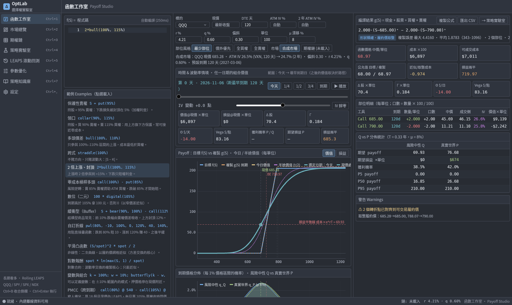
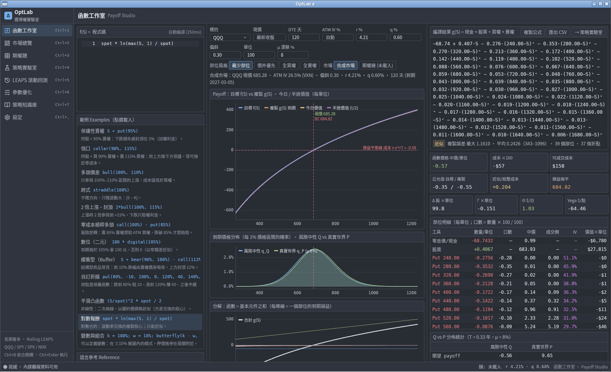

# OptLab 選擇權實驗室

用 Rust 寫的本地選擇權實驗軟體，介面使用 [GPUI](https://gpui.rs)（Zed 編輯器的 UI 框架）加上 gpui-component。

核心想法：**選擇權是一種程式語言**。股票的報酬是線性的；選擇權讓你組合出非線性、非對稱的報酬函數。OptLab 的主頁「函數工作室」讓你直接寫出想要的到期報酬 f(S)，由編譯器把它拆成最基本的「指令」：現金（零息債）、股票、`Call(K)`、`Put(K)`。接著用真實或合成的期權鏈替它定價，並顯示複製誤差、Greeks，以及在風險中性與真實世界機率下的報酬分佈。其他頁面（LEAPS 滾動回測、參數優化、崩盤壓力測試）則用來研究長期槓桿做多。



> ⚠️ 本軟體是研究工具，不是投資建議。歷史期權價格是用波動率指數合成的（見〈方法與限制〉）；槓桿部位在 2000 年型的崩盤中可能實質歸零。

---

## 目錄
- [Payoff 語言與編譯器](#payoff-語言與編譯器)
- [功能](#功能)
- [安裝與執行](#安裝與執行)
- [資料來源](#資料來源)
- [命令列 `optlab`](#命令列-optlab)
- [研究結論（截至 2026-11）](#研究結論截至-2026-11)
- [方法與限制](#方法與限制)
- [專案結構與測試](#專案結構與測試)

## Payoff 語言與編譯器

```text
# 變數、百分比（相對現價）、巨集與註解
k = 100%
cap = 115%
2 * bull(k, cap)                 # 上漲 2 倍參與到 +15%，下跌只賠權利金
```

| 類別 | 語法 |
|---|---|
| 變數 | `S` 到期價格、`spot` 現價、`110%` = 1.10 × spot、`a = 600` 定義變數、`;` 或換行分隔、`#` 註解 |
| 基本元件 | `call(K)` `put(K)` `digital(K)` `digitalput(K)` `pwl(x1,y1, x2,y2, …)`（用點直接畫折線） |
| 巨集 | `straddle(K)` `strangle(Kp,Kc)` `bull(K1,K2)` `bear(K1,K2)` `butterfly(K1,K2,K3)` `condor(…)` `collar(Kp,Kc)` `protect(K)` |
| 運算 | `+ - * / ^`、`max min abs pos neg clamp sqrt ln exp` |
| 跨到期日 | `expr @ N`：這部分在 N 天後到期，可加單位 `d/w/m/y`（`@ 45`、`@ 6m`、`@ 1y`）；未標記的部分用預設 DTE。不同到期日之間只能做線性組合（`+ − ×常數`） |

**編譯原理（靜態複製）：** 任何分段線性函數都可以精確寫成

```text
f(S) = a + b·S + Σᵢ wᵢ·(S − Kᵢ)⁺
```

其中 `wᵢ` 是轉折點 `Kᵢ` 的斜率變化。再用 put–call parity `(S−K)⁺ = (K−S)⁺ + S − K` 決定哪些轉折點用買權、哪些用賣權。

- **預設「最少部位」**：選擇所需股票部位最小的拆法。例如：
  - 多頭價差 → 兩個買權
  - 保護性賣權 → 零息債 + 買權（parity 等價的 fiduciary call）
  - 緩衝型結構商品 → 債券 + 買權價差 − 賣權
- **可交易履約價**：轉折點會對齊到可交易履約價，取整誤差會顯示出來。
- **跳躍**：數位選擇權這類跳躍，以相鄰履約價的窄價差近似。
- **平滑函數**：`ln`、`S²` 這類函數在履約價網格上做分段線性近似（Carr–Madan），並顯示近似誤差。

**跨到期日組合（日曆、對角、PMCC）：**

```text
call(80%) @ 540 - call(105%) @ 45          # PMCC：18 個月深價內 LEAPS + 每月賣 105% 買權
call(100%) @ 90 - call(100%) @ 30          # 日曆價差
strangle(95%, 105%) @ 60 - strangle(95%, 105%) @ 30   # 雙日曆
```

- 編譯器把程式拆成「每個到期日一組」，每組在自己的到期日上編譯；用真實期權鏈時，各組使用該到期日的掛牌履約價。
- 分析時點是**最早的到期日**：到期的部位按內在價值計，還沒到期的部位用 Black–Scholes（固定履約價的 IV）估值，得到「最早到期日時的組合價值 h(S)」。價格、分佈、獲利機率和損益兩平都以 h(S) 為準。
- 合成市場有 ATM 期限結構：近月 IV 與 2 年 IV 之間以總變異數內插。
- 像 `max(call@30, call@90)` 這種跨到期日的非線性組合是複合（路徑相依）選擇權，靜態複製表達不了，編譯器會直接報錯。
- 近月賣出的買權如果由遠月多頭部位覆蓋，會提示這是「備兌」，而不是裸賣。

**時間滑桿與 IV 情境：** 拖動日期滑桿（從今天到最早到期日），可以看任一天的資訊：
- 組合價值與損益曲線
- 現價處的損益與 Greeks
- 獲利機率（用當天的價格分佈計算）與損益兩平點

IV 滑桿（±20 個 vol 點）可以模擬 IV 崩跌或暴漲，例如財報後 IV 下降對日曆價差的影響。最早到期日之後，組合價值會取決於近月到期時的價格路徑，無法再畫成「現價 → 價值」的一條曲線，所以滑桿最遠只到最早到期日。

**定價與分析：**
- 價格：中價與可成交價（買在 ask、賣在 bid）。
- 公允值：用 Breeden–Litzenberger 由微笑曲線求出風險中性密度，積分得到公允值；與各腿價格吻合到約 0.01%。
- 真實世界分佈：以 Esscher tilt 把風險中性分佈調整成指定漂移 μ，求出期望損益、獲利機率、P5/P50/P95 與損益兩平點。
- 圖表（GUI）：目標 f(S) 對照複製 g(S)、今日與半途價值曲線、機率分佈，以及「函數 = 基本元件之和」的分解圖。

在命令列使用：

```bash
./target/release/optlab payoff --examples
```

```bash
./target/release/optlab payoff "S + bear(90%, 100%) - call(112%)" --symbol QQQ --days 365
```

```bash
./target/release/optlab payoff "pwl(80%,-10, 100%,0, 120%,40)" --chain-file my_snapshot.json
```

```bash
./target/release/optlab payoff "call(80%) @ 540 - call(105%) @ 45" --symbol QQQ
```

```bash
./target/release/optlab payoff "call(100%) @ 90 - call(100%) @ 30" --at 0,10,20,30 --vol-shift -5
```



## 功能

| 頁面 | 內容 |
|---|---|
| **函數工作室**（主頁） | 用 payoff 語言寫函數，自動編譯、即時定價，提供誤差、Greeks、Q/P 分佈與分解圖；可複製公式、匯出 CSV、送到策略實驗室 |
| **市場總覽** | 價格與 50/200 日均線、VXN/VIX 與實現波動、IV Rank/百分位、距高點回撤、趨勢狀態，以及依當前市況產生的建議卡片 |
| **期權鏈** | 從 CBOE（免金鑰）、Yahoo、Tradier、Polygon/Massive、本地快照或 CSV 讀取期權鏈。T 字報價（Bid/Ask/IV/Δ/OI）並標示價內與 ATM；預期波動、25Δ 偏斜、P/C 比、最大痛點、GEX 與 Gamma 翻轉點；IV 微笑、ATM 期限結構、GEX 長條圖；可存成快照或匯出 CSV |
| **策略實驗室** | 16 種內建策略（LEAPS 股票替代、PMCC、多頭價差、合成多頭、風險逆轉、領口、對角、鐵兀鷹…），每種都有中文說明。可從真實期權鏈或 Black-Scholes 合成市場建立；顯示損益圖（到期／今日／中間日）、部位 Greeks、損益兩平、最大損益、勝率、期望值，以及 Monte Carlo 損益分佈（GBM / Merton 跳躍 / Heston / 歷史拔靴） |
| **LEAPS 滾動回測** | 完整的滾倉規則：依 Delta 或價內程度選履約價、進場與滾倉 DTE、roll-up/down、停利、目標曝險、再平衡帶、權利金上限、整數口數、閒置現金收息、成本與危機價差、執行延遲、波動模型。輸出權益曲線，並與買進持有、每日再平衡槓桿 ETF、曝險配對線性部位比較；另有回撤、曝險/Delta、績效表、持有成本分析、逐年報酬與交易紀錄 |
| **參數優化** | 網格搜尋（6 種目標函數）。預設為**穩健優化**：以拔靴路徑中位數加上鄰格平滑計分，避免擬合單一歷史路徑。另有 Delta×DTE 熱圖、區塊拔靴穩健性（爆倉/近歸零/勝過基準機率）、walk-forward 樣本外驗證 |
| **策略知識庫** | 滾動 LEAPS 操作手冊、常見做法的綜合結論、LEAPS 持有成本表（Δ×DTE）、崩盤壓力表、所有策略說明 |
| **設定** | Tradier / Polygon 金鑰、預設資料來源、無風險利率、股息率、離線模式、快照清單、內建資料目錄 |

快捷鍵（macOS 用 ⌘，其他平台用 Ctrl）：`1`–`7` 切換頁面、`,` 開啟設定、`B` 收合側欄、`Enter` 執行目前頁面的主要動作、`Q` 離開。

## 安裝與執行

需要最新的 stable Rust（開發與測試使用 1.97；以 `rustup update` 更新）。

```bash
git clone https://github.com/yfwu/options && cd options
```

```bash
cargo run --locked --release -p optlab-app
```

- **macOS**：需要 Xcode Command Line Tools（`xcode-select --install`）。
- **Windows**：需要 MSVC Build Tools。
- **Linux**（Debian/Ubuntu）需要先安裝下列套件：

```bash
sudo apt-get install -y libxkbcommon-dev libxkbcommon-x11-dev libwayland-dev libx11-xcb-dev libxcb1-dev libvulkan-dev libfontconfig-dev libfreetype-dev libssl-dev pkg-config libzstd-dev
```

> `Cargo.lock` 把 `libc` 鎖在 0.2.189（較新版 libc 會讓 gpui 依賴的 `xattr 0.2.3` 編譯失敗）。請使用 `--locked`，不要直接執行 `cargo update`。

可用環境變數控制啟動方式：`OPTLAB_PAGE=backtest`（或 `studio|dashboard|chain|strategy|optimizer|guide|settings`）指定開啟頁面、`OPTLAB_AUTORUN=1` 啟動後自動執行、`OPTLAB_WINDOW=1560x930` 設定視窗大小、`OPTLAB_HOME=…` 改用可攜資料夾。

## 資料來源

**即時期權鏈**（需在你自己的電腦上連網執行）：

| 來源 | 金鑰 | 內容 |
|---|---|---|
| CBOE delayed quotes | 不需要 | 全鏈報價加 IV/Greeks，延遲約 15 分鐘。支援 `SPY`、`QQQ`，指數用 `_SPX`、`_NDX`、`_XSP`。**建議預設使用** |
| Yahoo Finance | 不需要（cookie + crumb） | 全鏈報價，無 Greeks（由本程式計算），也提供日線歷史 |
| Tradier | `TRADIER_TOKEN` | 含 ORATS Greeks 與 mid IV；支援 sandbox |
| Polygon / Massive | `POLYGON_API_KEY` | options snapshot（Greeks、IV、OI） |
| CSV | — | 自動辨識欄位的長格式匯入（thinkorswim、IB 等匯出檔） |

「自動」模式依序嘗試 CBOE → Yahoo → Tradier/Polygon（有金鑰時）→ 最新本地快照。每次抓取都會自動存成快照（`~/.local/share/optlab/chains/…`，macOS 為 `~/Library/Application Support/optlab`），日後可以用這些快照累積自己的歷史期權鏈。

**內建離線歷史資料**（編譯進執行檔，詳見 [`data/README.md`](data/README.md)）：

| 資料 | 期間 |
|---|---|
| QQQ | 1999 – 2026-11-03 |
| SPY | 1993 – 2026-11-03 |
| NVDA / MSFT / GOOG / AMZN / META / AVGO / TSM / VTI / SOXX | 近 10 年 |
| VIX | 1990 – 2026-11 |
| VXN | 2000-10 – 2026-11 |
| VIX3M | 2009 – 2026-10 |
| FRED 3 個月國庫券利率（DGS3MO） | 1981 – 2026-11 |

這些內建資料取自公開 GitHub 上的 Yahoo/CBOE/FRED 鏡像，已用已知數值抽查。在自己的電腦上請用即時來源更新。

## 命令列 `optlab`

引擎可以不開 GUI 單獨驗證、寫腳本或在 CI 中使用：

```bash
cargo build --locked --release -p optlab-cli
```

```bash
./target/release/optlab backtest --symbol QQQ --delta 0.8 --entry-dte 540 --roll-dte 180 --exposure 1.5
```

```bash
./target/release/optlab crash --symbol QQQ --exposures 1.0,1.25,1.5,2.0
```

```bash
./target/release/optlab robust --symbol SPY --exposure 1.5 --samples 300
```

```bash
./target/release/optlab optimize --symbol QQQ --robust --objective utility --param 0.5
```

```bash
./target/release/optlab walk-forward --symbol SPY
```

```bash
./target/release/optlab advise --symbol QQQ --kb
```

```bash
./target/release/optlab chain --symbol QQQ --provider cboe --strategy leaps
```

```bash
./target/release/optlab strategies pmcc --spot 600 --iv 0.2
```

`backtest`、`crash`、`robust` 也可加上 `--lr-vol/--iv-scale`（使用校準後的波動模型）、`--lag`、`--conservative`、`--integer`、`--start/--end`、`--json/--csv`（匯出結果）。

**在本機校準波動模型（建議）：** `optlab chain --symbol QQQ --provider cboe` 會依照真實期權鏈的 ATM 期限結構，擬合合成波動模型的 `long_run_vol` 與 `iv_scale`，並印出可直接使用的 `optlab backtest --lr-vol … --iv-scale …` 指令。

## 研究結論（截至 2026-11）

以下數字來自修正後的引擎：1 日執行延遲、雙因子 IV 期限結構、危機價差放大、FRED 利率、真實 VXN。設定為 0.80Δ、540 天進場、180 天滾倉、±25% 再平衡帶。研究過程另開了一個 session 做**獨立驗證**：用 Python 參考實作逐日對帳（誤差 ≤1e-7bp），完成 28,800 次壓力回測與 12,000 條拔靴路徑，報告見 [`docs/validation/REPORT.md`](docs/validation/REPORT.md)。

| 全期 | 1.0x | 1.5x | 2.0x | 買進持有 |
|---|---|---|---|---|
| QQQ 1999–2026 CAGR / 最大回撤 | 10.1% / −85% | 11.3% / −95.5% | 10.3% / −99%（近歸零，最低權益 4%） | 10.5% / −83% |
| SPY 1993–2026 CAGR / 最大回撤 | 10.1% / −60% | 12.2% / −80% | 14.4% / −91% | 10.7% / −55% |

1. **選擇權本身沒有免費的超額報酬。** 1.0x 的 LEAPS 每年約落後買進持有 0.5%，也落後「同曝險的線性部位」。早期版本顯示的「+1.6%/年」已由獨立驗證確認是模型假設的產物。
2. **曝險倍數是唯一一階重要的參數。** Δ（0.6–0.9）、進場/滾倉 DTE、再平衡帶都是二階效果，網格上的差異大多是雜訊。
3. **QQQ：** 只有約 1.0x 能撐過 2000 年型的 −83%，此時最低權益約 16%，和買進持有差不多。1.25x 為邊緣；≥1.5x 在高點建倉會剩 1–5%，回本需 13–26 年。長期來看，QQQ 的 CAGR 在 1–2.5x 之間幾乎不增加，回撤卻顯著加深（波動拖累 ≈ L²σ²/2）。
4. **SPY：** 波動較低，槓桿確實能提高長期報酬（2.0x 約 14%/年）。≤2.0x 在 40 個歷史起點中權益從未跌破初始的 10%，但仍需承受 −80% 到 −90% 的回撤。
5. **與每日再平衡槓桿 ETF（QLD/SSO 類）相比：** 在相同曝險下，LEAPS 的尾部略好，費用也較低；但差距不大，且在保守成本假設下會縮小。
6. **穩健優化器**（拔靴中位數）在 QQQ 與 SPY 上都選擇約 0.6Δ、730 天、1.0x。walk-forward 顯示重新優化在樣本外**不勝**預設參數，所以不要把網格的最高分當作答案。
7. **風險規則（Risk overlay）是目前找到最有效的保險，但不是 alpha。** 回測頁「風險規則」區或 CLI 的 `--sma 200 --sma-exposure 0`、`--dd-trigger 0.3 --dd-exposure 1.0` 可以啟用。規則是「標的跌破 200 日均線（±2% 緩衝）就把曝險降到上限，可降到 0 改持現金」，以及「權益自高點回撤超過門檻就降槓桿」。

   | QQQ 1.5x（1999–2026） | CAGR | 最大回撤 | 最低權益 | 拔靴近歸零機率 | 拔靴中位 CAGR |
   |---|---|---|---|---|---|
   | 無規則 | 11.3% | −95.5% | 15% | 6–7% | 11.0–12.1% |
   | 跌破 SMA200 → 現金 | 14.2% | −57% | 92% | 0.3–1.3% | 8.4–10.2% |

   - **確定成立的部分（尾部風險大降）**：2000 年起點的回撤從 −95% 降到 −56%，2022 年從 −50% 變成 +11%。SMA 長度 50–300、執行延遲 0–5 天、保守成本下，最大回撤都在 −50% 到 −77%，遠好於 −95%。
   - **要付的代價**：震盪市與 V 型反彈會來回停損（2015–16：−32% 對 −10%；2025 關稅：−3% 對 +15%）。拔靴（會打散趨勢）中位報酬約低 2%/年。歷史 CAGR 的提升（11.3% → 14.2%）有一部分是路徑運氣：SMA 長度不同時 CAGR 在 8.7–14.8% 之間，不穩定。
   - 同樣的規則套在「曝險配對的線性部位」上效果一樣甚至更好，所以好處來自趨勢規則本身，不是選擇權。
   - SPY 1.5x 加上 SMA200→現金：最大回撤 −80% → −28%，CAGR 12.2% → 12.6%。
8. 實務建議：若要開槓桿，SPY 比 QQQ 更合適；QQQ 建議不超過 1.0–1.25x，或搭配引擎外的降槓桿規則（例如權益跌破某水位就降低目標曝險）。進場前用「參數優化 → 區塊拔靴」確認近歸零機率，用「崩盤壓力測試」確認自己能承受的最壞情況。

## 方法與限制

- **歷史期權價格是合成的**：使用歷史收盤價，加上波動率指數（QQQ 用 VXN，SPY 用 VIX）驅動的 IV 曲面。曲面由雙因子期限結構與依 √T 縮放的偏斜組成，再以 Black-Scholes-Merton（含股息）定價。到期日固定為每月第三個星期五。免費的歷史期權鏈不存在，所以這是近似。
  - 2000-10 以前沒有 VXN，以 VIX×2.13 代替（2000–2002 期間 VXN/VIX 的中位數比值）。
  - 平靜市況下，模型的長天期 IV 略低於 VIX3M 所暗示的水準（長天期 LEAPS 略便宜，結果略偏樂觀）。σ_LR 每加 3 個點，QQQ 1.0x 每年約 −1.3%。請用 `optlab chain` 在本機以真實期權鏈校準。
- **成本**：半價差 SPY 0.6%、QQQ 0.75%，當波動指數超過門檻時依比例放大，另加每口 $0.65 手續費。`--conservative` 提供更保守的成本假設。
- **成交**：預設 1 日延遲（第 t 日收盤看到訊號、第 t+1 日收盤成交）。經獨立驗證，沒有使用未來資料。
- **未模擬的項目**：稅、提前履約、流動性枯竭時無法成交、保證金追繳（本策略只買權利金，不使用融資）。
- **台灣投資人**：選擇權資本利得一般不在美國預扣；買權持有人不收股息，所以也免除 30% 股息預扣稅（相較於直接持股是優點）。實際稅務請諮詢專業意見。SPX/XSP 為歐式、現金交割，美國稅制下適用 1256 條款（60/40），對非美國稅務居民的意義可能不同。

## 專案結構與測試

```
crates/core   optlab-core：payoff 語言與編譯器（payoff.rs）、定價（BSM/Greeks/IV/二元樹）、期權鏈模型、波動曲面與期權鏈分析、
              策略與 16 個範本、Monte Carlo、合成波動與成本模型、績效統計、
              LEAPS 滾動回測、優化器（網格/穩健/walk-forward/拔靴/熱圖）、建議引擎
crates/data   optlab-data：CBOE/Yahoo/Tradier/Polygon 供應者、CSV 匯入、快照儲存、設定、
              內建資料（include_str!）、研究預設 presets
crates/cli    optlab 命令列
crates/app    optlab-app：GPUI 桌面程式（7 個頁面、自繪圖表）
data/         內建歷史資料（附來源說明）
docs/         截圖、初步研究圖、獨立驗證報告
validation/   獨立驗證工具（Python 參考實作、Rust 重現程式、壓力測試腳本）
```

```bash
cargo test --locked -p optlab-core -p optlab-data -p optlab-cli
```

```bash
cargo test --locked -p optlab-data --test live -- --ignored --nocapture
```

```bash
cargo run --locked --release -p optlab-core --example leaps_study
```

- 第一個指令跑單元與整合測試：定價對照 Hull 教科書值，解析器使用真實擷取的期權鏈。
- 第二個指令跑需要網路的即時資料測試，請在本機執行。
- 第三個指令跑完整的 LEAPS 研究報告。

CI（`.github/workflows/ci.yml`）只在程式碼、資料或 workflow 變更時執行（文件、截圖、驗證報告不觸發）。同一分支的新 push 會取消進行中的舊 run。流程是先在 Linux 測試，通過後才在 Linux、macOS、Windows 上編譯桌面程式並上傳執行檔。

## 授權

MIT。內建資料的使用需遵守原始資料提供者（Yahoo、CBOE、Barchart、FRED）的條款。
