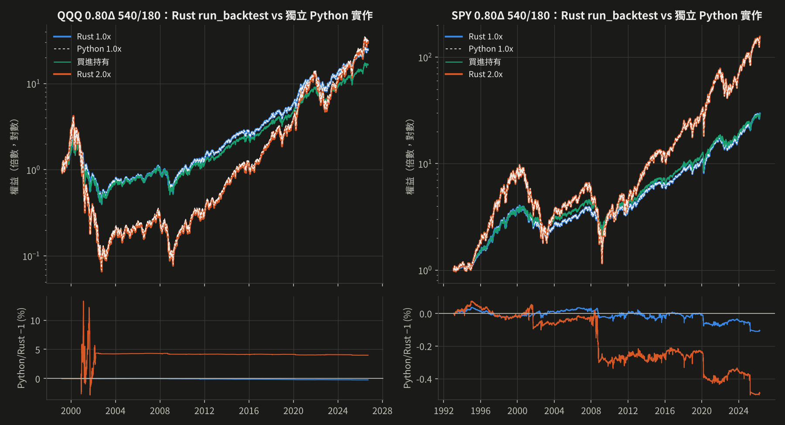
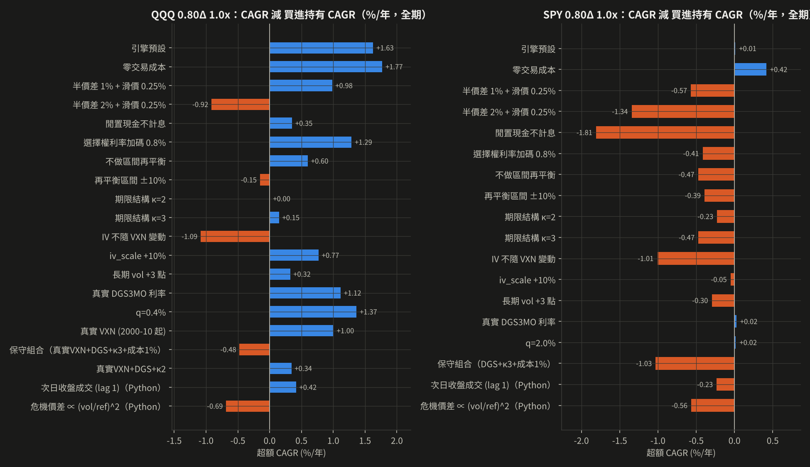
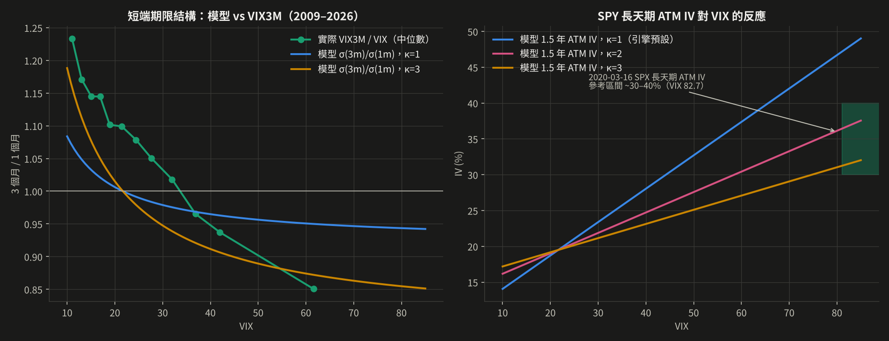
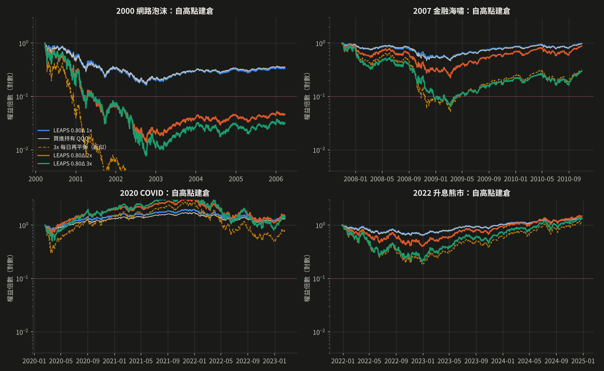
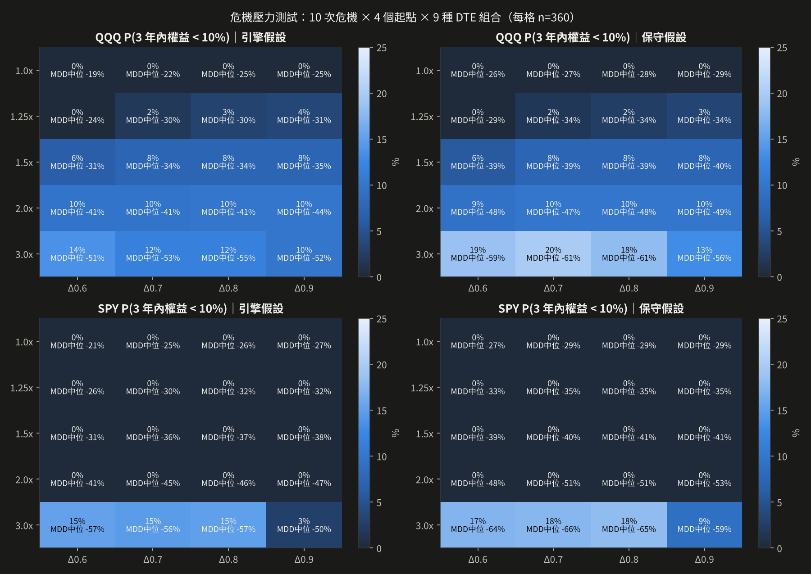
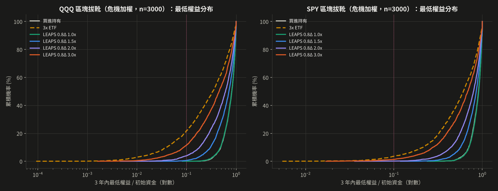

# OptLab 引擎獨立驗證報告：滾動 LEAPS 買權（QQQ / SPY）

> 驗證對象：`crates/core/src/{pricing,synth,stats,backtest,optimize}.rs`。主要分析在 commit `83d5b6a`（`claude/optimistic-carson-74sleg`）上完成；收尾時來源分支新增 `7140c6d`，已合併並重跑定價核對與回測複現（見 §2.4）。
> 驗證者未修改任何 `crates/*` 原始碼。所有程式、資料輸出與圖表位於 `validation/` 與 `docs/validation/`，`validation/run_all.sh` 可一鍵重現。
> 撰寫日期：2026-11-04。

---

## 0. 摘要

**驗證為正確的部分：**
- `pricing.rs` 的 BS 價格、Greeks、IV 反解：在 11,520 個格點上與 scipy 對照，最大誤差約 3e-9（`7140c6d` 改用 West 演算法後降到 6e-14）。Hull 教科書數值全部吻合。
- `synth.rs` 的曲面公式與文件一致，誤差 5e-13。
- `run_backtest` 的實作符合文件規則。以獨立 Python 依相同規則重寫，QQQ 1999–2026 與 SPY 1993–2026 共 10 組設定，CAGR 差距最大 0.16%/年，遠低於 0.5%/年門檻。
- 沒有發現使用未來資料（look-ahead）的錯誤。股息由買權持有人放棄這點，模型已正確處理。

**開發者標記的「1.0x 0.80Δ LEAPS 每年勝 QQQ 1.6%」不可信，大部分是模型假設的產物：**
1. 「1.0x」實際平均曝險為 1.10x，而且曝險會隨上漲而增加。用同一條曝險路徑做「每日再平衡、不用選擇權」的線性部位，CAGR 已有 12.07%（LEAPS 為 12.41%）。真正屬於選擇權的超額報酬只剩約 +0.3%/年。
2. 對假設非常敏感：
   - IV 不隨 VXN 變動：−1.1%/年
   - 期限結構 κ=2：0.0
   - 隔日收盤成交：+0.4
   - 價差隨危機放大：−0.7
   - 保守組合（真實 VXN、FRED 利率、κ=3、半價差 1%）：**−0.5%/年**
3. COVID 視窗 +51% 對 +33%：主因是 2020-03-09 一次重設履約價、把曝險拉回 1.0x，之後在反彈中被動加槓桿到約 1.17x。若不做區間再平衡，只剩 +37%。這是路徑運氣，不是穩定優勢。

**模型偏差（依影響大小排序）：**
1. **期限結構太黏 VIX**（κ=1）。VIX 82.7 時，模型給的 SPY 1.5 年 ATM IV 為 48%，市場參考值約 30–40%。危機中 LEAPS 被高估，回撤被低估，同時也把 LEAPS 的超額報酬灌水。
2. **QQQ 在 2009 年前的 vol 代理值偏低**。2000–2003 年模型 IV 平均比實現波動低 5.6 個 vol 點，網路泡沫期間 LEAPS 被低估。`data/VXN_barchart_2000.csv` 有真實 VXN 卻沒有使用。
3. **成本模型**。價差固定為中價的 0.5–0.6%，不隨危機放大。真實 DOV LEAPS 的半價差中位數為 4.4%（個股，只能當上限參考）。
4. **wipe-out 門檻是初始資金的 0.1%**。權益剩 1% 仍回報 `wiped=false`，摘要中「wiped false」嚴重誤導。
5. 其他：
   - 1.00x「槓桿 ETF」基準在 L=1 時也扣 0.95% 費用率，使基準被低估 1.1%/年。
   - `max_premium_pct` 上限讓 0.9Δ 3.0x 實際只有約 2.2x。
   - 利率表是憑記憶的近似值，`data/DGS3MO.csv` 有真實資料卻沒用。

**危機存活（壓力測試 28,800 次回測 + 區塊拔靴 4×3,000 條路徑）：**
- **QQQ**：
  - 只有 **1.0x**（任何 Δ）能在 2000 年 −83% 中保住權益 >10%：高點建倉時最低約 0.16，與買進持有相同。
  - **1.25x** 在網路泡沫中最低權益 0.08–0.36（依起點而定），回本需 11–20 年，為邊緣狀態。
  - **≥1.5x** 高點建倉時剩 1–5%，回本 13–26 年；3.0x 有 15–35% 的組合到 2026 年仍未回本。
  - 2.0x 在 GFC 回撤 −78%，3.0x 回撤 −94%。
- **SPY**：≤2.0x 在 40 個歷史起點中從未跌破 10%，但最差回撤 −86%。3.0x 有 15–18% 機率跌破 10%。
- **LEAPS 與每日再平衡槓桿 ETF 比較**：同名目槓桿下，LEAPS 的尾部略好（QQQ 3x：近歸零機率 12% 對 20%）。但在保守假設下差距大幅縮小。
- **Δ 與 entry/roll DTE**：對危機深度影響很小（中位 MDD 差異 ±3 個百分點）。**曝險倍數才是決定因素。**

---

## 1. 範圍、資料與方法

| 項目 | 內容 |
|---|---|
| 資料 | `data/QQQ_adj_1999.csv`（含息調整價）、`VXN_History.csv`（CBOE, 2009-09 起）、`VXN_barchart_2000.csv`（2000-10 起）、`VIX_History.csv`、`VIX3M_History.csv`、`VIX_SPY_1993.csv`、`DGS3MO.csv`；LEAPS 鏈：`crates/data/tests/fixtures/cboe_delayed_DOV_2026-09-10.json`（Yahoo QQQ 2025-02-24 fixture 只含當日到期合約，無 LEAPS，無法用於 carry 驗證） |
| Rust harness | `validation/harness/`：獨立 crate（不在 workspace members；複製 workspace `Cargo.lock`，libc 保持 0.2.189），只用 optlab-core 公開 API；資料載入與 `examples/leaps_study.rs` 完全相同，另加「真實 VXN」「DGS3MO」「q 覆寫」等替代資料 |
| Python 參考實作 | `validation/py/optlab_ref.py`：scipy BS/Greeks/IV、合成曲面、成本模型、依文件規則重寫的滾動回測（另加「隔日收盤成交」與「價差隨危機放大」兩個引擎沒有的旋鈕） |
| 重現 | `validation/run_all.sh`（約 2 分鐘；28,800 次壓力回測只需約 11 秒） |

---

## 2. 驗證為正確的部分

### 2.1 Black-Scholes（`pricing.rs`）

格點：買權與賣權 × K∈{50…160} × T∈{0.02…3} × r∈{0…10%} × q∈{0…2%} × σ∈{8%…150%}，共 11,520 點（`validation/out/pricing_check.txt`）。

| 量 | 最大絕對誤差 | 最大相對誤差 |
|---|---|---|
| 價格 | 2.8e-9（`7140c6d`：5.7e-14） | 2.2e-9 |
| Delta | 2.2e-11 | 9.4e-11 |
| Gamma / Vega | 6e-17 / 2e-16 | <1e-15 |
| Theta（每日） | 5.6e-13 | 4.7e-9 |
| Rho | 6.6e-11 | 9.4e-11 |
| IV 反解（vega>1e-4） | 6.3e-9（無 NaN） | — |
| `strike_for_delta(0.80)` | delta 誤差 2e-13 | — |

Hull 範例對照：
- 例 15.6（S=42, K=40, r=10%, σ=20%, T=0.5）：c=4.7594、p=0.8086。✔
- Greeks 例（S=49, K=50, T=20/52）：c=2.4005，Δ=0.5216，Γ=0.0655，Θ=−0.01180/日（−4.31/年），vega=0.1211/vol 點，ρ=0.0891/點。✔

### 2.2 合成曲面（`synth.rs`）

- `atm_vol` 與 `iv` 的 Python 重寫與 Rust 一致到 5e-13。
- `SynthVolModel::strike_for_delta` 的阻尼不動點只迭代 6 次，短天期（T≤0.25）的實際 delta 偏差最多 0.006。LEAPS 的偏差小於 0.001，可忽略。

### 2.3 回測引擎（`backtest.rs`）



| 設定 | Rust CAGR | Python CAGR | 差 (bp) | Rust MDD | Python MDD |
|---|---|---|---|---|---|
| qqq_d80_1.0 | 12.41% | 12.41% | -0.9 | -84.0% | -84.0% |
| qqq_d80_1.5 | 13.00% | 13.10% | +9.9 | -95.2% | -95.2% |
| qqq_d80_2.0 | 13.28% | 13.45% | +16.2 | -98.4% | -98.4% |
| qqq_d60_1.5 | 14.04% | 14.04% | -0.0 | -94.0% | -94.0% |
| qqq_d80_1.0_zero | 12.56% | 12.55% | -0.5 | -83.3% | -83.3% |
| spy_d80_1.0 | 10.73% | 10.73% | -0.4 | -56.4% | -56.4% |
| spy_d80_1.5 | 13.61% | 13.69% | +7.7 | -77.4% | -77.6% |
| spy_d80_2.0 | 16.42% | 16.40% | -1.7 | -88.2% | -88.2% |
| spy_d60_1.5 | 14.62% | 14.62% | -0.0 | -76.0% | -76.0% |
| spy_d80_1.0_zero | 11.14% | 11.14% | -0.2 | -54.7% | -54.7% |

- **Δ0.6 的兩邊完全一致**（差 <0.01bp）。
- **0.8Δ 的小差異**來自上面的 delta→strike 求解差異（Rust 阻尼不動點 vs Python 精確求根）。0.8Δ 的履約價位在偏斜較陡的區域，履約價差幾分錢就會改變 ±25% 區間觸發的日期，造成路徑相依。最大 16bp/年，低於 0.5%/年門檻。

逐項確認的規則：
- 現金在支付權利金**之後**才計息（不是整個權益計息）。
- 選擇權用 r+0.3% 定價、現金用 r 計息（偏保守）。
- 價格路徑由 `spot = adj·e^{q(T_last−t)}` 重建，並以 q 定價。買權不領股息這點**有被正確處理**：q=0.4% 對 0.7% 只差 −0.26%/年，且符號合理。
- 到期以內含價值結算；成交價套用半價差與手續費；vol 指數向前填補（只用 ≤ 當日的值）。
- **沒有未來資料。**

### 2.4 來源分支更新 `7140c6d` 之後

- `pricing.rs::norm_cdf` 改用 West/Hart 演算法：重跑後價格最大誤差 5.7e-14、delta 2.2e-16，IV 反解不變。`cargo test --locked -p optlab-core` 共 67 項全過。
- `backtest.rs` 與 `synth.rs` 未變；10 組複現回測的 Rust CAGR 與先前相同（到 1e-12）。本報告的回測數字全部適用於 `7140c6d`。
- 新增的 `optlab-data` presets（CLI/GUI 路徑）**已部分處理 B3/B5**：
  - QQQ 改用真實 VXN（2000-10 起），之前用 VIX×2.13。檢查 1999-04 至 2000-09：此代理值季平均 41–53，其後 1 年實現波動 45–60，比舊代理值合理得多。
  - 利率改用 FRED DGS3MO。
- 但 `examples/leaps_study.rs` 與 `docs/research/*` 仍用舊代理值與憑記憶的利率，所以開發者的初步結果（包含 +1.6%/年）仍受 B3/B5 影響。本報告的「保守假設」與新 presets 在 2000-10 之後大致相同。

---

## 3. 可疑結果審核

### 3.1 (a) 1.0x 0.80Δ LEAPS 勝 QQQ 買進持有 1.6%/年：真的嗎？

**結論：不可靠。** 這個優勢主要由以下三項構成：
- **槓桿實際上不是 1.0x**：平均約 1.10x，而且漂移方向是順勢的。
- **IV 動態的模型假設**。
- **同一收盤價決策並成交**。

把這些換成較保守但合理的假設後，優勢消失（−0.5%/年）。



**對照實驗**（全期，QQQ 0.80Δ 540/180 ±25% 1.0x；B&H CAGR 10.79%）：

| 變體 | LEAPS CAGR | 超額 (%/年) | 解讀 |
|---|---|---|---|
| 引擎預設 | 12.41% | **+1.63** | 開發者的結果 |
| IV 固定（κ→∞，IV 不隨 VXN 變動，只剩偏斜） | 9.70% | **−1.09** | 優勢完全來自 IV 動態 |
| 期限結構 κ=2 / κ=3 | 10.79% / 10.93% | 0.00 / +0.15 | κ=1 讓長天期 IV 對 VXN 太敏感 |
| 真實 VXN（2000-10 起，取代代理值） | 11.79% | +1.00 | 代理值讓網路泡沫期間的 LEAPS 太便宜 |
| 真實 DGS3MO 利率 | 11.90% | +1.12 | 憑記憶的利率表有偏差 |
| 半價差 1% + 滑價 0.25% / 2% + 0.25% | 11.77% / 9.87% | +0.98 / −0.92 | 成本敏感度高 |
| 價差 ∝ (VXN/25)²，於 VXN>25 時（Python） | 10.10% | −0.69 | 危機中價差放大 |
| 隔日收盤成交（Python，lag 1） | 11.20% | +0.42 | 同一收盤價決策並成交約貢獻 1.2%/年 |
| 不做區間再平衡 / 區間 ±10% | 11.39% / 10.63% | +0.60 / −0.15 | 對規則參數也敏感（=雜訊） |
| 閒置現金不計息 | 11.14% | +0.35 | 現金收益是**正確**的會計（LEAPS 內含融資），不是偏誤 |
| **保守組合**（真實 VXN + DGS3MO + κ=3 + 半價差 1%） | 10.31% | **−0.48** | |
| 真實 VXN + DGS3MO + κ=2（成本不變） | 11.13% | +0.34 | |

**曝險拆解：**
- 引擎的 `avg_exposure` 為 **1.102x**，中位數 1.13x。
- 原因：深價內買權在上漲時 delta 上升，而區間只在偏離 25% 時才調回。
- 以引擎每日實際曝險（前一日）做**線性**部位（不使用選擇權，融資成本 rf+0.3%），CAGR 為 **12.07%**。其中固定 1.10x 只有 11.22%，其餘來自曝險隨價格上升的「順勢」路徑。
- 因此 1.63%/年 ≈ 0.43（平均槓桿）+ 0.85（曝險路徑）+ **0.34（選擇權本身：凸性 − theta − 成本 + vega）**。
- 1999–2026 是 QQQ 的強勢期，任何「上漲時曝險變大」的規則都會受惠，這不是 LEAPS 獨有的優勢。

**Greeks 損益歸因**（`validation/out/attribution.txt`；逐日以前一日 Greeks 展開，年化算術加總）：

| %/年 | κ=1（預設） | κ=3 | IV 不變 |
|---|---|---|---|
| Δ 損益 | 14.84 | 13.97 | 13.43 |
| ½Γ dS² | 2.45 | 2.97 | 3.39 |
| Θ | −4.34 | −4.62 | −4.69 |
| Vega（含沿偏斜「下滾」） | 2.04 | 1.94 | 1.95 |
| 殘差（大跳動的高階項） | 0.30 | −0.33 | −1.00 |
| 現金利息 | 1.19 | 1.28 | 1.26 |
| 交易成本 | −0.63 | −0.59 | −0.55 |

Gamma 收益（2.5–3.4）不足以支付 theta（−4.3 至 −4.7）。

Vega 項約 +2%/年，即使 IV 不隨 VXN 變動也存在。原因是曲面用 `x = ln(K/S)/√T` 的「黏著價內程度」偏斜：
- 持有中的價內履約價，會隨 T 縮短、S 上漲而移往偏斜較陡處，IV 上升（skew roll-down）。
- 這在真實 SPX/QQQ 曲面上大致存在。但幅度取決於 `skew_slope` 的校準，**無法用手上資料驗證**。

**各疑點逐一檢查：**

| 疑點 | 判定 |
|---|---|
| VXN 飆升時的 IV/vega 加價 | **成立（主因之一）**：見 3.2，κ=1 太黏 |
| 同日收盤資訊成交 | **部分成立**：不是未來資料，但 lag-1 使 QQQ 超額 −1.2%/年；結果對一天的執行延遲就如此敏感，代表優勢不穩健 |
| look-ahead | **未發現**（vol 指數向前填補、利率用前一日、到期在 ≥ 到期日的第一根 K 線結算） |
| 股息沒被扣掉 | **已正確處理** |
| 現金收益算在含權利金的全權益上 | **否**：只有支付權利金後剩餘的現金計息 |
| 危機成本太低 | **成立**：見 3.4 |

**子期間：**
- 2009-10 以後（真實 VXN）超額 +1.51%/年，保守組合下只剩 +0.33%/年。
- SPY 1.0x 全期 +0.01%/年，保守組合為 −1.03%/年。

**COVID 視窗**（2020-02-19 至 2020-12-31）：LEAPS +50.9% 對 B&H +33.1%（開發者寫 +56%，可能是視窗或設定不同）。

| 變體 | 總報酬 |
|---|---|
| 引擎預設 | +50.9% |
| 不做區間再平衡 | +36.7% |
| IV 不變 | +45.4% |
| κ=3 | +45.0% |
| 隔日成交（Python） | +46.6% |
| 以相同曝險路徑的線性部位 | +40.9% |

交易紀錄只有一次重設：2020-03-09（QQQ −18%、delta 0.60，觸發「曝險與 Delta 皆偏離」），以 IV 42% 重新買進 0.80Δ。此後 delta 漲到 0.98，曝險漂到 1.17x 仍在 ±25% 區間內，沒有再調整。超額報酬約有一半是「低點附近被動加回槓桿 + 反彈中曝險變大」，其餘是極端實現波動下的 gamma 與 vega。**V 型反彈的路徑紅利不能外推到 2000 或 2008 型的熊市。**

### 3.2 (b) 危機中的期權定價是否合理？



**短端（可用資料驗證）：** 以 VIX3M/VIX 檢查模型的 σ(3m)/σ(1m)。

| VIX 區間 | 實際 VIX3M/VIX | 模型 κ=1 |
|---|---|---|
| <15 | 1.178 | 1.048 |
| 15–20 | 1.131 | 1.020 |
| 20–30 | 1.079 | 0.995 |
| 30–45 | 0.999 | 0.974 |
| >45 | **0.860** | **0.954** |

- 單一 κ 無法同時擬合低波動的陡峭正價差與高波動的深度逆價差：用全部資料擬合 κ=7.0，只用 VIX>30 擬合 κ=1.2。
- 模型 κ=1 在 VIX>45 時，3 個月 IV 仍有 1 個月的 95%，實際只有 86%。

**長端（無資料，以市場參考值比對）：**

| 日期 | VIX | 模型 SPY 1 年 / 1.5 年 ATM | 參考 |
|---|---|---|---|
| 2008-11-20 | 80.9 | 53.2% / 47.1% | SPX 1 年 ATM 約 40–45% |
| 2020-03-16 | 82.7 | **54.2% / 47.9%** | SPX 1 年 ATM 約 30–40%（VIX3M 當日 67.7） |
| 2025-04-08 | 52.3 | 36.9% / 33.8% | — |
| QQQ 2020-03-16 | VXN 80.1 | 55.2% / 49.5% | — |

（參考值來自公開市場紀錄與文獻，不是本資料集，誤差約 ±5 個 vol 點。）

**結論：`synth.rs` 有均值回歸的期限結構，但 κ=1 太慢。** 在 VIX>60 時，長天期 IV 高估約 10–20 個 vol 點。影響如下：
- **危機谷底的 LEAPS 市值被高估**：0.80Δ 18 個月買權的 vega 約為價格的 1.5%/vol 點，高估 15 點 ≈ 部位價值高估 20%+。回撤因此看起來比實際淺。
- **危機中滾倉或重設時買得太貴**（這部分偏保守），賣出舊部位時也賣得太貴。
- **反轉後 IV 回落時，有 vega 損失**。

淨效果：κ 從 1 改到 2–3，全期 QQQ 1.0x 超額由 +1.6 降到 0–0.15，COVID 期間 MDD 從 −21% 加深到 −24% 至 −25%。

**QQQ 2009 年前的代理值：** `max(VIX×1.23, 1.1×RV21)` 與真實 VXN（Barchart）比較。

| 年 | 代理值平均 | 真實 VXN 平均 |
|---|---|---|
| 2000（10 月起） | 70.0 | 79.4 |
| 2001 | 59.0 | 61.5 |
| 2002 | 45.8 | 50.7 |
| 2003 | 28.8 | 34.3 |
| 2008 | 41.0 | 35.5 |

另以模型 1 年 ATM IV 對其後 1 年實現波動比較，QQQ 1999–2003 為 **35.3% 對 41.0%（−5.6 個 vol 點）**。網路泡沫期間 LEAPS 的定價比實際風險便宜，有利於買方，屬於偏誤。2009 年後模型 VRP 為 +2.4，大致合理。

**危機價差：** `CostModel` 是固定比例，沒有危機放大。若危機中半價差 ∝ VXN/25 或 (VXN/25)²，QQQ 1.0x 全期分別 −1.3 與 −2.3%/年。這是**未知量**，報告應以區間呈現。

### 3.3 (c) 0.80Δ 長天期買權的 carry

DOV 2026-09-10（S=191.42，r=4.0%，q≈1.1%，iv30=24.9%），2028-01-21 到期（T=1.36 年）：

| | K | IV | 中價 | Δ | 外在價值（%S/年） | 半價差（%中價） |
|---|---|---|---|---|---|---|
| 實際（K=160） | 160 | 29.1% | 47.40 | 0.803 | 6.12% | 4.4% |
| 模型（SPY 曲面參數，30 天 ATM=iv30） | 159.1 | 26.8% | 45.63 | 0.80 | **5.11%** | 0.5% |
| 實際，內插到 K=159.1 | 159.1 | 29.1% | 47.99 | 0.807 | **6.01%** | — |

- **Carry：** 模型比 DOV 實際便宜約 15%（外在價值 5.1% 對 6.0%/年）。原因之一是個股的長天期期限結構與偏斜比指數陡，因此只能說「同一量級，模型可能略低」。引擎在 QQQ 1999–2026 的平均 carry 為 6.0%/年（Δ 名目），SPY 為 3.7%/年。
- **價差：** 0.6–0.95Δ DOV LEAPS 的半價差中位數為 4.4%（四分位 3.5–5.8%），是引擎假設的 7 倍。DOV 是低流動性個股，SPY/QQQ LEAPS 實際約在 0.3–1%。但本環境無法連到 CBOE 取得 SPY/QQQ 長天期報價，**建議以實盤報價抽樣校準**。
- **QQQ fixture：** Yahoo QQQ 2025-02-24 只有 0DTE 合約，不能用。

---

## 4. 發現的錯誤與偏誤（含最小重現與修正建議）

最小重現：`cd validation/harness && cargo run --release --bin repro`，輸出如下。
```
R1  wipe-out flag vs real loss (−85% linear crash, 0.80Δ 540/180):
    1.0x  wiped_out=false  min equity = 12.76% of initial  MDD = -87.7%
    2.0x  wiped_out=false  min equity = 0.90% of initial  MDD = -99.2%
    3.0x  wiped_out=true  min equity = 0.10% of initial  MDD = -99.9%
R2  1.00x 'leveraged' benchmark is charged the expense ratio:
    B&H final 0.1500  vs  '每日再平衡 1.00x' final 0.1458  (should be equal)
R3  long-dated IV in a VIX spike (SynthVolModel::spy, κ=1):
    VIX  82.7: ATM 1y 54.2%  1.5y 47.9%  (2020-03-16 reference: 1y SPX ATM ≈ 30–40%)
R4  requested vs realised exposure when max_premium_pct binds (flat market):
    Δ0.9 target 3.0x → realised avg exposure 2.61x
```

| # | 嚴重度 | 問題 | 影響 |
|---|---|---|---|
| B1 | 高（呈現） | wipe-out 門檻為初始資金的 0.1%（`backtest.rs` `wipe_level = initial_capital * 1e-3`）；`docs/research/summary.txt` 中 2.0x MDD −98.4% 仍顯示「wiped false」 | 讀者會誤判存活 |
| B2 | 高（模型） | 期限結構 κ=1：VIX 80 時長天期 IV 高估 10–20 個 vol 點；短端在高波動時太平 | 危機回撤被低估；全期超額 +1.6 → κ=2 時為 0 |
| B3 | 高（資料） | QQQ 2009 年前 vol 代理值偏低（2000–03 年約 −5 個 vol 點）；`VXN_barchart_2000.csv` 未使用 | 網路泡沫期間 LEAPS 太便宜 |
| B4 | 中 | 成本固定比例，危機不放大；0.6% 半價差相對 DOV 實測偏低（SPY/QQQ 待驗） | ±1–2%/年 |
| B5 | 中 | 利率為憑記憶的近似表（`approx_us_tbill_rates`）；`DGS3MO.csv` 未使用 | QQQ 1.0x −0.5%/年 |
| B6 | 中 | 「1.0x」平均 1.10x；基準應與實際曝險配對；1.00x 槓桿 ETF 基準在 L=1 時仍扣 0.95% 費用率 | 對基準的超額被高估約 1.5%/年 |
| B7 | 中 | 決策與成交都用同一收盤價（與 VXN 收盤）；沒有執行延遲選項 | lag-1 使 QQQ −1.2%/年 |
| B8 | 低 | `max_premium_pct` 上限使實際曝險低於目標（0.9Δ 3.0x → 約 2.2–2.6x），但 label 與最佳化器仍顯示 3.00x | 最佳化結果被錯誤解讀 |
| B9 | 低 | 最佳化網格雜訊：QQQ 0.6Δ 1.25x CAGR 15.1%，1.5x 為 14.0%；0.8Δ 1.0x 為 12.4%，1.25x 為 12.3%；相鄰格點差 1–3%/年且不單調 | 網格最佳化會挑到雜訊 |
| B10 | 低 | `strike_for_delta` 阻尼迭代 6 次上限，短天期 delta 誤差最多 0.006 | 可忽略 |

**修正建議（程式片段，未套用）：**

B1：除了 wipe-out，也回報最低權益與「近乎歸零」。
```rust
// backtest.rs — SimOut / BacktestResult
pub min_equity_ratio: f64,          // min(equity)/initial_capital
pub near_wipe: bool,                // min_equity_ratio < cfg.near_wipe_level (default 0.10)
// in simulate(): after computing `eq`
out.min_equity_ratio = out.min_equity_ratio.min(eq / cfg.initial_capital);
```

B2：雙因子期限結構（以 VIX3M/VIX 初步校準；長端應再以 VIX6M/VIX1Y 或實際 LEAPS IV 校準）。
```rust
// synth.rs — 75% 的衝擊以 κ_f≈4 快速回歸，25% 以 κ_s≈0.5 慢速回歸
pub fn atm_vol(&self, t: f64, vol_index_pts: f64) -> f64 {
    let t = t.max(1.0 / 365.0);
    let w = |k: f64| { let kt = k * t; if kt < 1e-8 { 1.0 } else { (1.0 - (-kt).exp()) / kt } };
    let shock = (vol_index_pts / 100.0 * self.iv_scale).max(0.0) - self.long_run_vol;
    (self.long_run_vol + shock * (0.75 * w(4.0) + 0.25 * w(0.5))).clamp(self.min_vol, self.max_vol)
}
// SPY：VIX 12/20/40/82.7 → σ3m/σ1m = 1.13/1.01/0.92/0.86（實際 1.18/1.10/1.0/0.86）；
//      VIX 82.7 → 1y 40%, 1.5y 36%（κ=1 時為 54%/48%）
```

B3/B5：資料載入改用真實序列（`examples/leaps_study.rs::qqq_data`）。
```rust
let bc = read_col("VXN_barchart_2000.csv", 4);            // Barchart VXN, 2000-10 →
pts.retain(|p| p.0 < bc[0].0);                            // proxy only before 2000-10-10
pts.extend(bc.iter().copied().filter(|p| p.0 < first_vxn));
// rates: RateSource::Series(ScalarSeries::new("DGS3MO", read_col_allow_zero("DGS3MO.csv", 1)))
```

B4：成本隨 vol 指數放大。
```rust
pub struct CostModel { /* … */ pub crisis_ref_vol: f64, pub crisis_exp: f64 }
pub fn half_spread(&self, mid: f64, vol_idx: f64) -> f64 {
    let base = (self.half_spread_pct * mid).max(self.min_half_spread);
    if self.crisis_ref_vol > 0.0 && vol_idx > self.crisis_ref_vol { base * (vol_idx / self.crisis_ref_vol).powf(self.crisis_exp) } else { base }
}
```

B6：基準修正，並加入曝險配對基準。
```rust
// leveraged_curve(): 1x 不應扣費用率
let er = if lev > 1.0 + 1e-9 { er } else { 0.0 };
// 新增：exposure-matched 線性基準，v *= 1 + e_{t-1}·r_t − (e_{t-1}−1)·(rf+spread)·dt
```

B7：`RollConfig { exec_lag_days: u32 }`。觸發在 t 收盤判斷，於 t+lag 收盤以當時價格成交（參考 `validation/py/optlab_ref.py` 的 `trade_lag`）。

B8：`label()` 改顯示實際平均曝險；最佳化器應略過 `avg_exposure / target < 0.85` 的組合，或明確標註。

B9：以拔靴或 walk-forward 的中位數作為目標函數，或對網格結果做鄰域平滑。不要用單一歷史路徑的 argmax。

---

## 5. 危機壓力測試

**設定：**
- 危機：10 次（2000 網路泡沫、2007 GFC、2011-08、2015-08、2016-01、2018-02、2018-Q4、2020 COVID、2022、2025-02）。
- 起點：每次危機 4 個（高點、前 1/3/6 個月；高點為各區間內含息收盤價最高日）。
- 參數網格：Δ{0.6,0.7,0.8,0.9} × 曝險{1.0,1.25,1.5,2.0,3.0} × entry DTE{365,540,730} × roll DTE{90,180,270}。
- 兩套假設：引擎預設，以及**保守假設**（QQQ 使用 2000-10 起真實 VXN；兩者皆用 DGS3MO、κ=3、半價差 1% + 滑價 0.25%）。
- 兩個標的，共 28,800 次回測。
- 指標：MDD 與最低權益取起點後 3 年內；回本 = 從起點到權益重回初始資金的年數（追蹤到 2026 年資料結束）。
- 2x/3x ETF 代理 = 每日再平衡、融資成本 rf+0.5%、費用率 0.95%。



格式：3 年內 MDD / 最低權益（倍數）/ 回本年數（💀 = 引擎 wipe-out）

#### QQQ：於高點建倉，0.80Δ 540/180 天，3 年內最大回撤 / 最低權益 / 回本年數

| 危機 | 起點 | B&H | 2x ETF | 3x ETF | LEAPS 1.0x | 1.5x | 2.0x | 3.0x | 3.0x (保守假設) |
|---|---|---|---|---|---|---|---|---|---|
| 2000 網路泡沫 | 2000-03-27 | -83% / 0.17 / 14.9 | -99% / 0.01 / 20.4 | -100% / 0.00 / 未回本 | -84% / 0.16 / 14.4 | -95% / 0.05 / 17.8 | -99% / 0.01 / 20.1 | -99% / 0.01 / 19.8 | -100% / 0.00 / 26.1 |
| 2007 金融海嘯 | 2007-10-31 | -53% / 0.47 / 3.1 | -83% / 0.17 / 4.4 | -95% / 0.05 / 6.0 | -53% / 0.47 / 3.0 | -70% / 0.30 / 3.2 | -78% / 0.22 / 3.2 | -94% / 0.06 / 6.0 | -93% / 0.07 / 5.7 |
| 2011-08 美債降評 | 2011-07-26 | -16% / 0.84 / 0.5 | -31% / 0.69 / 0.5 | -44% / 0.56 / 0.5 | -14% / 0.88 / 0.2 | -19% / 0.82 / 0.5 | -24% / 0.76 / 0.5 | -35% / 0.65 / 0.5 | -42% / 0.58 / 0.5 |
| 2015-08 人民幣 | 2015-07-20 | -16% / 0.85 / 1.0 | -31% / 0.69 / 1.0 | -45% / 0.55 / 1.2 | -18% / 0.87 / 0.7 | -21% / 0.80 / 1.0 | -28% / 0.73 / 1.1 | -42% / 0.59 / 1.2 | -47% / 0.53 / 1.5 |
| 2016-01 | 2015-12-01 | -16% / 0.84 / 0.7 | -31% / 0.69 / 0.7 | -43% / 0.57 / 0.7 | -16% / 0.86 / 0.6 | -24% / 0.80 / 0.7 | -29% / 0.73 / 0.7 | -41% / 0.59 / 1.1 | -46% / 0.54 / 1.1 |
| 2018-02 Volmageddon | 2018-01-26 | -29% / 0.85 / 1.0 | -52% / 0.66 / 1.1 | -70% / 0.50 / 1.2 | -22% / 0.85 / 1.0 | -32% / 0.77 / 1.1 | -42% / 0.69 / 1.1 | -57% / 0.54 / 1.2 | -65% / 0.52 / 1.2 |
| 2018-Q4 | 2018-08-29 | -29% / 0.77 / 0.6 | -52% / 0.57 / 0.9 | -70% / 0.42 / 1.2 | -22% / 0.80 / 0.6 | -30% / 0.71 / 0.6 | -37% / 0.64 / 0.6 | -53% / 0.49 / 0.7 | -64% / 0.39 / 1.3 |
| 2020 COVID | 2020-02-19 | -35% / 0.71 / 0.3 | -63% / 0.48 / 0.3 | -81% / 0.30 / 0.4 | -39% / 0.79 / 0.2 | -55% / 0.70 / 0.2 | -66% / 0.66 / 0.2 | -79% / 0.50 / 0.3 | -78% / 0.34 / 0.3 |
| 2022 升息熊市 | 2021-12-27 | -35% / 0.65 / 2.0 | -63% / 0.37 / 2.4 | -81% / 0.19 / 2.5 | -36% / 0.64 / 2.0 | -51% / 0.49 / 2.0 | -60% / 0.40 / 2.1 | -80% / 0.20 / 2.5 | -80% / 0.20 / 2.5 |
| 2025-02 關稅衝擊 | 2025-02-19 | -23% / 0.77 / 0.3 | -42% / 0.58 / 0.4 | -57% / 0.43 / 0.4 | -19% / 0.81 / 0.3 | -26% / 0.74 / 0.2 | -34% / 0.66 / 0.2 | -51% / 0.49 / 0.4 | -60% / 0.40 / 0.4 |


#### SPY：於高點建倉，0.80Δ 540/180 天，3 年內最大回撤 / 最低權益 / 回本年數

| 危機 | 起點 | B&H | 2x ETF | 3x ETF | LEAPS 1.0x | 1.5x | 2.0x | 3.0x | 3.0x (保守假設) |
|---|---|---|---|---|---|---|---|---|---|
| 2000 網路泡沫 | 2000-03-24 | -48% / 0.52 / 6.6 | -79% / 0.21 / 14.6 | -93% / 0.07 / 18.5 | -53% / 0.47 / 11.9 | -71% / 0.29 / 13.6 | -81% / 0.19 / 14.2 | -94% / 0.06 / 19.7 | -95% / 0.05 / 18.4 |
| 2007 金融海嘯 | 2007-10-09 | -55% / 0.45 / 4.9 | -84% / 0.16 / 6.0 | -96% / 0.04 / 7.4 | -56% / 0.44 / 4.9 | -72% / 0.28 / 5.5 | -82% / 0.18 / 5.5 | -94% / 0.06 / 6.7 | -94% / 0.06 / 6.2 |
| 2011-08 美債降評 | 2011-04-29 | -19% / 0.81 / 0.8 | -36% / 0.64 / 0.9 | -52% / 0.48 / 0.9 | -14% / 0.86 / 0.5 | -20% / 0.80 / 0.5 | -27% / 0.73 / 0.8 | -41% / 0.59 / 0.8 | -52% / 0.48 / 0.9 |
| 2015-08 人民幣 | 2015-07-20 | -13% / 0.87 / 0.7 | -27% / 0.73 / 1.0 | -39% / 0.61 / 1.0 | -12% / 0.88 / 1.0 | -19% / 0.81 / 1.0 | -25% / 0.75 / 1.0 | -37% / 0.63 / 1.0 | -42% / 0.58 / 1.4 |
| 2016-01 | 2015-11-03 | -13% / 0.87 / 0.5 | -25% / 0.75 / 0.6 | -36% / 0.64 / 0.7 | -11% / 0.89 / 0.6 | -17% / 0.83 / 0.6 | -23% / 0.77 / 0.6 | -34% / 0.66 / 0.6 | -39% / 0.61 / 0.6 |
| 2018-02 Volmageddon | 2018-01-26 | -34% / 0.81 / 2.2 | -59% / 0.55 / 2.3 | -76% / 0.34 / 2.5 | -27% / 0.84 / 1.1 | -38% / 0.77 / 1.1 | -49% / 0.67 / 2.2 | -50% / 0.53 / 1.8 | -73% / 0.36 / 2.4 |
| 2018-Q4 | 2018-09-20 | -34% / 0.79 / 1.6 | -59% / 0.53 / 1.7 | -76% / 0.33 / 1.9 | -27% / 0.83 / 0.5 | -38% / 0.76 / 0.5 | -49% / 0.71 / 0.5 | -55% / 0.57 / 0.8 | -73% / 0.37 / 1.7 |
| 2020 COVID | 2020-02-19 | -34% / 0.66 / 0.5 | -59% / 0.41 / 0.5 | -76% / 0.24 / 0.9 | -27% / 0.74 / 0.3 | -38% / 0.62 / 0.3 | -48% / 0.52 / 0.3 | -61% / 0.50 / 0.3 | -74% / 0.26 / 0.5 |
| 2022 升息熊市 | 2022-01-03 | -24% / 0.76 / 1.9 | -47% / 0.53 / 2.1 | -64% / 0.36 / 2.4 | -23% / 0.77 / 1.5 | -32% / 0.68 / 1.5 | -41% / 0.59 / 2.0 | -64% / 0.36 / 2.2 | -63% / 0.37 / 2.2 |
| 2025-02 關稅衝擊 | 2025-02-19 | -19% / 0.81 / 0.3 | -35% / 0.65 / 0.4 | -49% / 0.51 / 0.4 | -11% / 0.89 / 0.2 | -17% / 0.83 / 0.2 | -23% / 0.77 / 0.2 | -38% / 0.62 / 0.4 | -47% / 0.53 / 0.4 |


**起點敏感度：** 提前 1–6 個月建倉，結果大致相同或略好，因為多累積了一段漲幅。完整表見 `stress_tables.md`。

#### QQQ 存活表（引擎預設假設）

樣本 = 10 次危機 × 4 個起點 × 3 entry DTE × 3 roll DTE（每格 n=360）。格式：P(權益<10%) / 最差 3 年 MDD / 中位 MDD / P(到資料結束仍未回本)

| 曝險 \ Δ | 0.6 | 0.7 | 0.8 | 0.9 |
|---|---|---|---|---|
| 1.0x | 0% / -84% / -19% / 0% | 0% / -87% / -22% / 0% | 0% / -87% / -25% / 0% | 0% / -85% / -25% / 0% |
| 1.25x | 0% / -91% / -24% / 0% | 2% / -93% / -30% / 0% | 3% / -93% / -30% / 0% | 4% / -93% / -31% / 0% |
| 1.5x | 6% / -95% / -31% / 0% | 8% / -96% / -34% / 0% | 8% / -96% / -34% / 0% | 8% / -96% / -35% / 0% |
| 2.0x | 10% / -98% / -41% / 0% | 10% / -98% / -41% / 0% | 10% / -99% / -41% / 0% | 10% / -99% / -44% / 0% |
| 3.0x | 14% / -100% / -51% / 4% | 12% / -100% / -53% / 2% | 12% / -100% / -55% / 0% | 10% / -99% / -52% / 0% |

對照（同樣 40 個起點）：B&H P(<10%) 0% 最差 MDD -83% 中位 -29% 未回本 0%；2x：10% / -99% / -52% / 0%；3x：20% / -100% / -70% / 8%


#### QQQ 存活表（保守假設：真實 VXN(2000-10 起)/DGS3MO/κ=3/半價差 1%+滑價 0.25%）

樣本 = 10 次危機 × 4 個起點 × 3 entry DTE × 3 roll DTE（每格 n=360）。格式：P(權益<10%) / 最差 3 年 MDD / 中位 MDD / P(到資料結束仍未回本)

| 曝險 \ Δ | 0.6 | 0.7 | 0.8 | 0.9 |
|---|---|---|---|---|
| 1.0x | 0% / -82% / -26% / 0% | 0% / -86% / -27% / 0% | 0% / -86% / -28% / 0% | 0% / -85% / -29% / 0% |
| 1.25x | 0% / -90% / -29% / 0% | 2% / -92% / -34% / 0% | 2% / -91% / -34% / 0% | 3% / -92% / -34% / 0% |
| 1.5x | 6% / -95% / -39% / 0% | 8% / -95% / -39% / 0% | 8% / -95% / -39% / 0% | 8% / -96% / -40% / 0% |
| 2.0x | 9% / -98% / -48% / 0% | 10% / -98% / -47% / 0% | 10% / -99% / -48% / 0% | 10% / -99% / -49% / 1% |
| 3.0x | 19% / -100% / -59% / 4% | 20% / -100% / -61% / 6% | 18% / -100% / -61% / 2% | 13% / -100% / -56% / 2% |

對照（同樣 40 個起點）：B&H P(<10%) 0% 最差 MDD -83% 中位 -29% 未回本 0%；2x：10% / -99% / -52% / 0%；3x：20% / -100% / -70% / 8%


#### SPY 存活表（引擎預設假設）

樣本 = 10 次危機 × 4 個起點 × 3 entry DTE × 3 roll DTE（每格 n=360）。格式：P(權益<10%) / 最差 3 年 MDD / 中位 MDD / P(到資料結束仍未回本)

| 曝險 \ Δ | 0.6 | 0.7 | 0.8 | 0.9 |
|---|---|---|---|---|
| 1.0x | 0% / -55% / -21% / 0% | 0% / -58% / -25% / 0% | 0% / -58% / -26% / 0% | 0% / -58% / -27% / 0% |
| 1.25x | 0% / -64% / -26% / 0% | 0% / -67% / -30% / 0% | 0% / -68% / -32% / 0% | 0% / -67% / -32% / 0% |
| 1.5x | 0% / -71% / -31% / 0% | 0% / -74% / -36% / 0% | 0% / -74% / -37% / 0% | 0% / -76% / -38% / 0% |
| 2.0x | 0% / -82% / -41% / 0% | 0% / -85% / -45% / 0% | 0% / -86% / -46% / 0% | 0% / -87% / -47% / 0% |
| 3.0x | 15% / -94% / -57% / 0% | 15% / -96% / -56% / 0% | 15% / -96% / -57% / 0% | 3% / -95% / -50% / 0% |

對照（同樣 40 個起點）：B&H P(<10%) 0% 最差 MDD -55% 中位 -29% 未回本 0%；2x：0% / -84% / -53% / 0%；3x：15% / -96% / -70% / 0%


#### SPY 存活表（保守假設：DGS3MO/κ=3/半價差 1%+滑價 0.25%）

樣本 = 10 次危機 × 4 個起點 × 3 entry DTE × 3 roll DTE（每格 n=360）。格式：P(權益<10%) / 最差 3 年 MDD / 中位 MDD / P(到資料結束仍未回本)

| 曝險 \ Δ | 0.6 | 0.7 | 0.8 | 0.9 |
|---|---|---|---|---|
| 1.0x | 0% / -59% / -27% / 0% | 0% / -60% / -29% / 0% | 0% / -59% / -29% / 0% | 0% / -59% / -29% / 0% |
| 1.25x | 0% / -68% / -33% / 0% | 0% / -68% / -35% / 0% | 0% / -68% / -35% / 0% | 0% / -68% / -35% / 0% |
| 1.5x | 0% / -75% / -39% / 0% | 0% / -76% / -40% / 0% | 0% / -76% / -41% / 0% | 0% / -77% / -41% / 0% |
| 2.0x | 0% / -85% / -48% / 0% | 0% / -86% / -51% / 0% | 0% / -87% / -51% / 0% | 0% / -88% / -53% / 0% |
| 3.0x | 17% / -95% / -64% / 0% | 18% / -96% / -66% / 0% | 18% / -97% / -65% / 1% | 9% / -94% / -59% / 1% |

對照（同樣 40 個起點）：B&H P(<10%) 0% 最差 MDD -55% 中位 -29% 未回本 0%；2x：0% / -84% / -53% / 0%；3x：15% / -96% / -70% / 0%




**重要說明：** 歷史樣本裡只有**一次** −83% 等級的事件（2000 年 QQQ）。每格 P(<10%) 的 8–10% 幾乎就等於「網路泡沫的 36 個樣本全部跌破 10%」。這個機率反映的是「在 10 次危機中有 1 次這樣的事件」，**不是**一般化的機率估計。

**Δ / DTE / 再平衡的影響（QQQ，引擎假設）：**
- **Δ：** 同曝險下 MDD 中位數差距 ≤6 個百分點。0.9Δ 3.0x 看起來較安全，只是因為 `max_premium_pct` 讓實際曝險只有約 2.2–2.6x（B8）。
- **entry/roll DTE：** 中位 3 年 MDD 差異 ≤4 個百分點，沒有一致方向（附錄表）。
- **再平衡區間：** ±10/25/50%/不做再平衡，對 QQQ 3.0x 的最低權益第 10 百分位為 0.11/0.06/0.07/0.08，2.0x 為 0.17/0.20/0.19/0.21，**沒有本質差異**。原因是每次滾倉（約每年一次）都會把槓桿重設回目標值；危機持續超過一年時，就等同持續加回槓桿。

### 5.1 區塊拔靴（聯合報酬 + vol 指數變化）

方法：
- 平穩區塊拔靴，平均區塊長 60 日。報酬與 vol 指數的日變化一起抽樣；log-vol 每日以 5% 拉回來源區塊水準。
- 路徑長 3 年（756 日），利率固定 3%。
- 兩種抽樣：「無條件」與「危機加權」（15% 的新區塊強制從 vol≥35 的日子開始）。
- 每種 3,000 條路徑。下表另取「B&H 在 3 年內 MDD ≤ −30%」的子集作為合成危機情境。



| 情境（QQQ） | 配置 | P(權益<10%) | P(期末<50%) | MDD 中位 | 3 年終值中位 |
|---|---|---|---|---|---|
| 無條件，全部（n=3000） | 買進持有 | 0.0% | 1.8% | -32% | 1.45 |
| 無條件，全部（n=3000） | 2x ETF | 2.0% | 13.7% | -57% | 1.52 |
| 無條件，全部（n=3000） | 3x ETF | 13.0% | 26.7% | -75% | 1.36 |
| 無條件，全部（n=3000） | LEAPS 0.8Δ 1.0x | 0.0% | 2.3% | -33% | 1.45 |
| 無條件，全部（n=3000） | LEAPS 0.8Δ 1.5x | 0.1% | 7.6% | -45% | 1.57 |
| 無條件，全部（n=3000） | LEAPS 0.8Δ 2.0x | 1.6% | 12.4% | -55% | 1.64 |
| 無條件，全部（n=3000） | LEAPS 0.8Δ 3.0x | 6.3% | 19.3% | -69% | 1.66 |
| 無條件，全部（n=3000） | LEAPS 0.8Δ 2.0x（保守） | 2.0% | 13.0% | -57% | 1.57 |
| 無條件，全部（n=3000） | LEAPS 0.8Δ 3.0x（保守） | 10.9% | 24.2% | -73% | 1.48 |
| 危機加權，B&H MDD≤−30%（n=2006） | 買進持有 | 0.0% | 6.2% | -45% | 1.07 |
| 危機加權，B&H MDD≤−30%（n=2006） | 2x ETF | 7.2% | 32.5% | -75% | 0.76 |
| 危機加權，B&H MDD≤−30%（n=2006） | 3x ETF | 32.7% | 55.1% | -90% | 0.42 |
| 危機加權，B&H MDD≤−30%（n=2006） | LEAPS 0.8Δ 1.0x | 0.0% | 7.3% | -46% | 1.06 |
| 危機加權，B&H MDD≤−30%（n=2006） | LEAPS 0.8Δ 1.5x | 0.9% | 19.3% | -61% | 0.97 |
| 危機加權，B&H MDD≤−30%（n=2006） | LEAPS 0.8Δ 2.0x | 5.8% | 30.4% | -73% | 0.84 |
| 危機加權，B&H MDD≤−30%（n=2006） | LEAPS 0.8Δ 3.0x | 17.3% | 41.4% | -84% | 0.68 |
| 危機加權，B&H MDD≤−30%（n=2006） | LEAPS 0.8Δ 2.0x（保守） | 6.7% | 30.6% | -74% | 0.81 |
| 危機加權，B&H MDD≤−30%（n=2006） | LEAPS 0.8Δ 3.0x（保守） | 27.6% | 48.9% | -88% | 0.53 |

拔靴中的「保守」只包含 κ=3 與半價差 1% + 滑價 0.25%（vol 路徑仍取自引擎的 QQQ 資料）。

（買進持有曲線在圖中與 LEAPS 1.0x 幾乎重疊。完整表含 SPY 與 Δ0.6/0.9，見 `boot_tables.md`。）

**SPY**（危機加權，B&H MDD ≤ −30% 子集，n=885）：P(權益<10%) 分別為：
- B&H 0%、LEAPS 0.80Δ 1.5x 0%、2.0x 0.5%、3.0x 4.4%（保守 8.5%）、3x ETF 12.4%。

**拔靴的限制：**
- 區塊長 60 日，無法產生 2000–2002 那種長達 30 個月的連續熊市；長期尾部被低估，歷史壓力測試的結果更重要。
- QQQ 樣本包含 2009 年前的代理 vol（偏低，見 B3）。

---

## 6. 哪些參數能撐過危機

以「3 年內權益不低於初始資金 10%，且在資料期間內能回本」為存活標準。

| 標的 | 存活（含 2000 型 −83%） | 邊緣 | 不存活 |
|---|---|---|---|
| **QQQ** | **1.0x**，任何 Δ（0.6–0.9）與 DTE；最差 MDD −82% 至 −87%；網路泡沫最低權益 0.14–0.54（高點建倉約 0.16，和買進持有幾乎一樣） | **1.25x**：網路泡沫最低權益 0.08–0.36，最差 MDD −91% 至 −93%，回本 11–20 年 | **≥1.5x**：網路泡沫最低權益 1.5x 為 0.04–0.26、2.0x 為 0.01–0.12、3.0x 為 0.001–0.10；回本 13–26 年，3.0x 有 15–35% 的組合未回本；3.0x 在 GFC 也剩 6% |
| **SPY** | **≤2.0x**：40 個起點從未跌破 10%；但 2.0x 在 GFC/2000 的 MDD 為 −81% 至 −87%，回本 5–14 年 | 2.0x（保守假設下最差 −87% 至 −88%） | **3.0x**：P(<10%) 15–18%（GFC、2000） |

**要點：**
1. **曝險倍數是唯一一階重要的參數。** Δ、entry/roll DTE、再平衡區間都是二階效果，而且在網格上的差異大多是雜訊（B9）。
2. LEAPS 在同名目槓桿下，尾部**略好於**每日再平衡槓桿 ETF。例如 QQQ 2.0x 網路泡沫：LEAPS 最低 0.01、2x ETF 也是 0.01；GFC：LEAPS 0.22 對 2x ETF 0.17。但優勢不大，而且在保守假設下縮小。**不要把 LEAPS 視為「有保護的槓桿」**：每次滾倉與再平衡都會把槓桿重設回目標值，凸性只保護單一張合約，不保護策略。
3. 若目標是「長期看多、用 LEAPS 加槓桿」，在 QQQ 上 >1.25x 必須接受「2000 型事件 = 實質歸零」這個尾部。若要在 QQQ 用 1.5–2.0x，需要加上 engine 外的風控：例如權益跌破某水位就降低目標曝險（目前引擎沒有這個功能），或改用 SPY。
4. 「勝過買進持有」的期望值應以 **0 ± 1%/年**（1.0x）看待，不是 +1.6%/年。

---

## 7. 限制

- 長天期 IV 的「市場參考值」不是來自本資料集（網路被封鎖，無法取得 CBOE/OptionMetrics），誤差約 ±5 個 vol 點。期限結構的長端只能部分驗證。
- 價差只有一條 DOV 個股長天期鏈可用，SPY/QQQ 的實際 LEAPS 價差未驗證。
- QQQ 2000-10 以前仍需用代理 vol。2000-03 至 2000-10 的網路泡沫前段，即使在「保守假設」下也偏便宜。
- 拔靴的利率固定為 3%，並假設報酬與 vol 的區塊抽樣足以重現危機的動態。
- 本報告主要驗證 commit `83d5b6a`，並已在 `7140c6d` 上重跑核心核對。`optimize.rs` 仍在開發中，本報告只使用了它的 bootstrap 方法作為設計參考，沒有驗證其最佳化與 walk-forward 結果。

---

## 附錄：檔案

| 路徑 | 內容 |
|---|---|
| `validation/harness/src/main.rs` | Rust harness（pricing/synth 網格、jobs、boot、inputs） |
| `validation/harness/src/bin/repro.rs` | 最小重現 R1–R4 |
| `validation/py/optlab_ref.py` | 獨立 Python 參考實作 |
| `validation/py/check_pricing.py`、`replicate.py`、`term_structure.py`、`chain_check.py`、`robustness_py.py`、`attribution.py` | 第 2–3 節 |
| `validation/py/make_stress.py`、`analyze_stress.py`、`make_jobs.py`、`analyze_boot.py`、`charts.py` | 第 5 節與圖表 |
| `validation/out/*.txt, *.csv, *.md` | 數值結果（大型 jsonl 已 gitignore，以 `run_all.sh` 重生） |
| `docs/validation/stress_tables.md`、`boot_tables.md` | 完整壓力測試與拔靴表格 |
